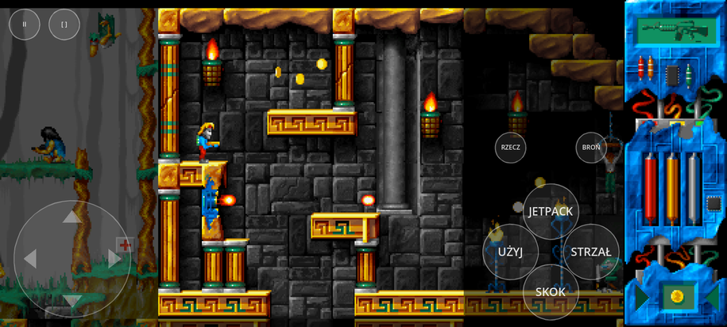

# Lazarus '97: Revibed

A modern remake of **Lazarus** (Infinite Dreams, MS-DOS, Polish), a room-based action-adventure platformer
with a jetpack, guns, inventory puzzles and Polish humour — and the reverse-engineering groundwork it is
built on. **Revibed is based on the DOS version released in 1997** (published by TimSoft; its title screen
says 1996, when it was made), itself a port of the 1995 Amiga game.

**[`remake/`](remake/README.md)** — the game in Godot 4.7: plays in a web browser, widescreen / HD with
crisp pixels, keyboard, gamepad and on-screen touch controls, Polish or English, the original's rules
ported tick for tick. **Play it in the browser: <https://mbialkowski.github.io/lazarus-revibed/>**

| widescreen | phone (touch) |
|---|---|
|  |  |

The original:

| title | gameplay | dialogue |
|---|---|---|
|  |  |  |

## How it was made

Everything in this repository (the reverse engineering of the original executable and data files, the
documentation, the Python tools, the annotated decompilation and the Godot remake with its tests) was
produced by **Claude**, Anthropic's AI model, working in Claude Code, under the supervision of a human
(the repository owner). The human set the direction, played the builds and reported what to change;
Claude did the analysis, wrote the code and docs, and checked the results against the original running in
DOSBox.

## Compared to the original

The game rules are the original's, ported from the decompiled code and run at its 50 Hz: hero and object
movement match the original tick for tick (63 golden traces), the rooms match the original pixel for
pixel, and a scripted playthrough of the winning route (every item, lock, flag and dialogue on the way)
reaches the ending. Around that:

**Fixes**

* Shots that touch harmful tiles no longer hurt the hero (an original bug in `TileCollide`).
* The riddle scroll shows the right picture for the third riddle (the original shows the second one's).
* Entering a room no longer leaves the hero stuck inside a platform at its edge (the original places him
  there without checking, e.g. when jumping up from the ledge in room (5,8) into (5,7)).

The original's other quirks are kept ([docs 4.8](docs/reverse-engineering/04-game-content.md)).

**Upgrades and new features**

* **Runs anywhere**: in any current browser on computers and phones, with no DOS, DOS4GW or sound-card
  setup.
* **Saving**: the game saves each time the hero enters a room and *Graj dalej* (continue) resumes there;
  in the original one death was the end.
* **Widescreen and HD**: up to 16:9 and wider, with the neighbouring rooms shown (dimmed) around the
  hero's room and a camera that glides between rooms; crisp, evenly sized pixels at any resolution; on 4:3
  screens it looks like the original. The VGA palette effects (fades, the bomb alarm, explosions) are exact.
* **Touch controls** for phones and tablets (pad and buttons, sideways or upright, tap the HUD to switch
  item or weapon, tap to continue a dialogue), **gamepad** support and extra keys (WASD and others).
* **English**: all 293 messages translated, English subtitles for the text painted into the intro, and a
  language choice on the first screen (the original Polish is the default).
* **Menus**: a title menu (Nowa gra, Graj dalej, Opcje, Sterowanie, Autorzy, Wyjście), a pause menu, an
  options screen and a controls screen that lists the keys or the touch buttons.
* **Options**: neighbouring rooms on/off and dimmed, smooth or sharp scaling, touch controls, sound
  on/off, music and effect volumes, music while playing (the original has none during the game; on by
  default), full screen.
* **Phones**: installs as a full-screen app (*Add to Home Screen*), plays sound even with an iPhone in
  silent mode, and suggests turning the phone sideways.
* **Intro**: any key or tap skips it, and its last picture goes on to the title by itself.

## What is here

* [`docs/reverse-engineering/`](docs/reverse-engineering/README.md) — complete write-up of the executable,
  every data file format, the engine rules and physics constants, and the full game content (items, NPCs,
  quests, endings), plus notes for the remake.
* [`assets/`](assets/README.md) — every asset of the original converted to modern formats: tilesets,
  sprites with animation/collision metadata, all 100 rooms as JSON and **Tiled** maps (+ world file),
  world maps, region/collision debug maps, WAV sound effects, MOD music, intro/ending animation frames, pictures, a BMFont of the
  dialogue font, all texts (Polish + English draft), game tables (weapons, items, scripts, physics) and
  catalogues (world graph, enemies, hero spec, sound usage, unused content).
* [`reference/`](reference/README.md) — annotated Ghidra decompilation of `LAZARUS.EXE` for porting exact
  behaviour.
* [`original/`](original/README.md) — **not included**: where to put your own copy of the original DOS
  files (needed only to regenerate the assets or run the original), with their checksums and a DOSBox
  config.
* [`tools/`](tools/) — the Python tools that produced all of the above from the original files.
* [`remake/`](remake/README.md) — the Godot 4 remake (web export, tests).


## Regenerating

Needs your own copy of the original DOS files in `original/` (see [`original/README.md`](original/README.md)).

```bash
pip install -r tools/requirements.txt
python3 tools/extract_assets.py original/ assets/ --render-music   # --render-music needs openmpt123 + oggenc
python3 tools/dump_rooms.py original/ --quests
cd original && dosbox -conf dosbox.conf                              # play the original
python3 tools/build_remake_data.py original/ remake/data/           # the remake's data bundle
godot --path remake                                                  # play the remake (Godot 4.7)
```

## License

* **Code and documentation written for this project are MIT licensed** (see [`LICENSE`](LICENSE)): the
  remake's code (`remake/` apart from `remake/data/`), the Python tools (`tools/`), the tests and the docs.
* **The original game and all of its content are not.** All copyrights to Lazarus and everything in it
  (the program, graphics, animations, music, sound effects, texts, story and characters) remain with
  **Infinite Dreams**, the original developer (the DOS game was published in 1997 by TimSoft), and the other
  original rights holders, such as the composer of the music. That covers the original DOS files (not
  included in this repository) and everything derived from them: `assets/`, `reference/` (the decompilation),
  `remake/data/` and the game data of the published web build, the screenshots in `docs/images/`, and the
  game's texts and pictures quoted in the docs. This repository grants no licence to them.
