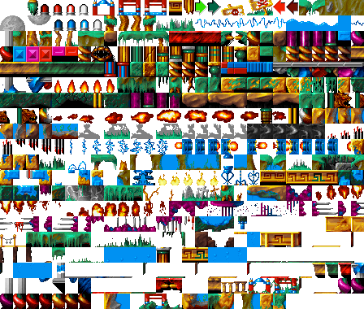
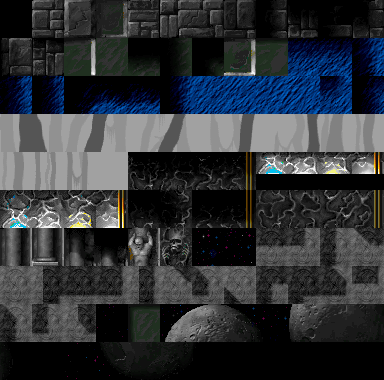
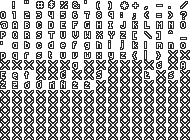

# 2. Resource file formats

All `DATAxx.RES` names are opaque; the original names come from error messages left in the EXE
(`NEWROOM.BIN`, `KLOCKI.DAT` "blocks", `PSIZES.BIN`, `bob_make.bin`, `BOBY.BIN`, `OBJECTS.BIN`).
Data that came from the Amiga tools is **big-endian**; data produced on the PC is little-endian.

Every format below has a reader in [`tools/lazarus_data.py`](../../tools/lazarus_data.py) and an exporter in
[`tools/extract_assets.py`](../../tools/extract_assets.py).

## 2.1 Overview

| file | size | original name | format | used for |
|---|---|---|---|---|
| DATA01 | 145 920 | – | Mode X tiles 32×38 ×120 | room background layer |
| DATA02 | 760 804 | BOBY.BIN | BOB frame pixels | all sprites |
| DATA03 | 10 668 | bob_make.bin | BOB descriptors | frame timing, offsets, hit boxes |
| DATA04 | 856 901 | – | FLC 320×240, 19 fr | "AUTORZY" (credits) |
| DATA05–09, 11 | | – | FLC 320×200 | intro |
| DATA10, 13–15 | | – | FLC 320×240 | intro (Mode X part) |
| DATA12 | 119 122 | – | FLI 320×200 | intro |
| DATA16 | 768 | – | palette | bomb alarm (red) |
| DATA17 | 89 353 | – | FLC 320×240, 6 fr | winning ending (back home, shrunk) |
| DATA18 | 520 | – | tile types (old) | **unused** |
| DATA19 | 768 | – | palette | loaded, unused |
| DATA20 | 105 845 | – | PCX 640×480×16 | "GAME OVER" |
| DATA21 | 96 722 | – | PCX 640×480×16 | joke ending (witch's herbs) |
| DATA22 | 5 217 | – | PCX 264×90×16 | Infinite Dreams logo shown by the DOS stub at start-up |
| DATA23 | 43 952 | – | ProTracker MOD "multifruit juice" | title-menu music (there is no in-game music) |
| DATA24 | 170 240 | KLOCKI.DAT | Mode X tiles 16×19 ×560 | platform layer |
| DATA25 | 768 | – | palette | **main game palette** |
| DATA26 | 27 552 | – | bitmap font | all dialogue text |
| DATA27 | 768 | – | palette | full-screen pictures (maps, riddles) |
| DATA28 | 768 | – | palette | title menu |
| DATA29 | 45 800 | NEWROOM.BIN | 100 room records | tile maps |
| DATA30 | 68 674 | OBJECTS.BIN | room object lists | enemies, items, NPCs, triggers |
| DATA31 | 18 240 | – | Mode X image 76×240 | HUD side panel |
| DATA32 | 620 | – | 1 byte / tile | tile collision type |
| DATA33–36 | | – | PCX 320×200/400 ×256 | intro stills (text pages) |
| DATA37 | 4 160 | PSIZES (old) | | **unused** |
| DATA38 | 4 960 | PSIZES.BIN | 4 × BE u16 / tile | tile collision boxes |
| DATA39 | 93 886 | – | ProTracker MOD "recollection" | intro / ending music |
| DATA40 | 65 660 | – | PCX 640×2080×16 | end credits scroller |
| DATA41 | 71 016 | – | raw signed 8-bit PCM | all sound effects |

## 2.2 Palettes (DATA16/19/25/27/28)

768 bytes, 256 × RGB, 6-bit VGA components (0–63). Scale with `c * 255 / 63`.
The whole game world uses **DATA25** only (there are no per-region palettes). Derived palettes built at
run time: all-black, all-white (`0x3F`), and "red" (= DATA25 red channel only, used when the hero explodes).

## 2.3 Mode X planar images (DATA01, DATA24, DATA31, BOBs, font)

The game runs in unchained VGA "Mode X" 320×240, and stores images pre-split into the four VGA planes:

```
for plane in 0..3:
    for y in 0..h-1:
        for b in 0..w/4-1:
            pixel(x = b*4 + plane, y) = next_byte()
```

* **DATA24 platform tiles**: 16×19 px, 304 bytes each, 560 tiles. Colour 0 is transparent.
* **DATA01 background tiles**: 32×38 px, 1 216 bytes each, 120 tiles, opaque.
* **DATA31 HUD**: one 76×240 image drawn at x=244.



*DATA24 platform tiles (28 per row) — `assets/tiles/platform_tileset.png`.*



*DATA01 background tiles — `assets/tiles/background_tileset.png`.*

## 2.4 Tile attributes (DATA32, DATA38)

* **DATA32** – one byte per platform tile (620 entries; the game reads 660 into a zeroed buffer):
  `0` (stored, replaced by `4` at load) = **solid**, `1` = **harmful** (hurts the hero, does not block),
  `2` = **passable** (decoration).
* **DATA38 (PSIZES.BIN)** – per tile four big-endian u16 `x0, y0, x1, y1`: the solid rectangle inside the
  16×19 cell. The loader keeps only the low byte of each word. (`DATA37` is an older, shorter copy.)

## 2.5 NEWROOM.BIN (DATA29) – room maps

10 × 10 rooms, record size 458, file order `row * 10 + col` (row-major). Room `(col,row)` at
`(row*10+col) * 458`.

| offset | size | content |
|---|---|---|
| `0x000` | 20 × 4 | **animated tiles**: `[col \| 0x80 fg-flag, row, sequence, start]`, unused entries have `sequence = 0xFF` |
| `0x050` | 7 × 6 | background tile indices (DATA01), row-major, one byte each |
| `0x07A` | 14 × 12 × 2 | platform tile indices (DATA24), **big-endian u16**, row-major |

Play-field = 14×12 platform cells of 16×19 = **224×228 px**, drawn at screen `(0,6)`; the background
grid 7×6 of 32×38 covers the same area. Tile `0` is empty.

Animated-tile *sequences* are not in the data files: they are a table inside the EXE (`0x50004`,
76 sequences, each `u16 header, i16 tile…, -1`). One entry is shown per game tick (50 Hz), looping; the
room entry's `start` is the initial offset (to de-synchronise torches). Animated tiles keep their tile
type, so animated fire is harmful. `tools/lazarus_exe.py` extracts the table (`gamedata/tile_anims.json`).

## 2.6 BOB sprites (DATA03 descriptors + DATA02 pixels)

**DATA03** (little-endian):

```
u32 file_size (10668)   u32 count (1184)   u32 pixel_data_size (760804 = size of DATA02)
count × 9-byte descriptor:
    i8  duration   ticks this frame is shown; -1 = separator between animation groups
    u32 offset     into DATA02
    u8  x0, y0, x1, y1   collision box relative to the frame's top-left
```

Descriptors are numbered globally (separators included); **animation group *n*** = the run of frames after
the *n*-th separator. The engine addresses sprites either by global frame index (hero, HUD, pictures) or by
group number (room objects). There are 229 groups.

**DATA02** frame: `u8 width/4, u8 height`, then Mode X planar pixels (`width*height` bytes). Colour 0 is
transparent.

Notable groups (see [`assets/sprites/overview/`](../../assets/sprites/overview/) and `assets/sprites/sprites.json`): 0/1 hero walk L/R, 199–207 hero jump/jet/crouch/idle,
211 hero teleport, 9 & 212 explosion, 67 coin, 208 inventory icons, 209 weapon icons, 210 full-screen
pictures (frames 1077–1083: 3 maps, a hint scroll, 3 riddles) + HUD tubes (1084 empty, 1085 energy,
1086 fuel, 1087 ammo), 213–225 projectiles, 226 title-menu background + menu labels.

## 2.7 OBJECTS.BIN (DATA30) – room objects

Big-endian. Rooms in the same row-major order as NEWROOM:

```
room:   u16 object_count, 8 bytes unused
        object_count × object
object: 14-byte header, then header[1] × 32-byte path step
```

**Header** (byte offsets):

| off | type | meaning |
|---|---|---|
| 0 | u8 | loop-start step (used when end mode = 2) |
| 1 | u8 | number of path steps |
| 2 | u8 | interaction bits: `0x02` needs item `[13]` *selected* in the inventory, `0x04` activated by **crouching** on it (floor pickups), `0x08` static (never erased) |
| 3 | u8 | end-of-path mode: `0` stop, `1` vanish, `2` loop from `[0]`, `3` disable forever, `≥4` restart at step 0 |
| 4–5 | u16 | low byte = sound played when activated. The high byte is `0x08` on the 380 objects that have an activation sound — the editor's "play" command bit (as in path-step sound words); the engine reads only `hdr[4..5] & 0xFF` |
| 6–7 | u16 | **flags** (below) — the engine writes back into this field, so object state persists between room visits |
| 8 | u8 | current HP. `0xFF` = indestructible and blocks bullets, `0xFE` = bullets pass through |
| 9 | u8 | initial HP (copied to `[8]` when the path resets) |
| 10–11 | i16 | animation group played on activation/death (`0x8000` bit = none), e.g. 9 explosion, 118 coin sparkle |
| 12 | u8 | **target**: `< 20` = index of another object in the room to activate; `≥ 20` = **script id** (sets `g_gameFlags[id]=1` and calls script handler) |
| 13 | u8 | required item id, or game-flag index when flags & `0x0004` |

**Flags** (`[6..7]`):

| bit | name | meaning |
|---|---|---|
| `0x0001` | active | object exists / is drawn |
| `0x0002` | — | set on most objects but **never tested by the engine** (an editor-only bit); `editor-0x0002` in the JSON |
| `0x0004` | needs-flag | interaction ignored until `g_gameFlags[hdr[13]]` is set |
| `0x0008` | invisible | never drawn (sound emitters, trigger zones) |
| `0x0010` | chain | on activation also activates object `index+1` |
| `0x0020` | touch | activates on contact (no *use* key) |
| `0x0040` | disabled | permanently gone (set by end mode 3 – collected items) |
| `0x0080` | keep | stays after activation instead of vanishing |
| `0x0100` | rearm | path is reset and object re-armed after activation (reusable terminals) |
| `0x3C00` | class | collision class = `(flags & 0x3C00) >> 7`: `0x08` inert, `0x10` **harmful**, `0x20` **usable/pickup**, `0x40` **solid platform** |
| `0x4000` | fires | when activation finishes, fire header `[12]` (object or script) |
| `0x8000` | conditional | see below |

**Conditional objects** (`0x8000`) are resolved when the room is entered (`RoomObject_ctor`, `0x21D5C`):

* with *needs-item* (`hdr[2] & 2`): usable only while item `hdr[13]` is selected; if `g_gameFlags[hdr[13]]`
  is already set (the lock was opened before) the object spawns already activated;
* with *needs-flag* (`0x0004`): spawns activated if `g_gameFlags[hdr[13]]` is set, otherwise waits;
* neither, and `hdr[13] > 2`: the object **exists only once `g_gameFlags[hdr[13]]` is set** (e.g. the second
  merchant at (9,3) appears after you talked to the first; platforms at (1,3) appear after the riddle);
* neither, and `hdr[13] <= 2`: spawns hidden and waits to be activated by another object (debris, NPCs that
  appear after a door opens…).

**Path step** (32 bytes, all big-endian; positions and velocities are 16.16 fixed point):

| off | type | meaning |
|---|---|---|
| 0, 4 | i32 | acceleration x, y (added to velocity each tick) |
| 8, 12 | i32 | velocity x, y at the start of the step |
| 16, 20 | i32 | position x, y at the start of the step (absolute, room pixels) |
| 24 | u16 | bits 0–9 duration in ticks; bit 15 = when the step starts, activate object `(w >> 10) & 0x1F` |
| 26 | u16 | animation group (bit 15 unused by the engine) |
| 28 | u16 | bits 0–14 start offset into the animation (ticks); bit 15 = **object hidden** during this step |
| 30 | u16 | sound command: bits 11–13 = `1` play / `3` stop; bits 0–9 = sound id |

Per tick: `v += a; pos += v` for `duration` ticks, then the next step. This single mechanism drives
patrolling enemies, flying birds, turret shots (a hidden step = reload delay), lifts, collectibles, NPC
idle animations and ambient sound emitters.

## 2.8 Bitmap font (DATA26)

```
224 bytes   glyph advance widths for characters 0x20..0xFF (Mazovia code page)
224 glyphs  each: u8 width/4 (=3), u8 height (=10), 120 bytes Mode X planar (12×10 cell)
```



Glyph pixel `1` = body (in the `{c}` colour), `2` = dark outline (palette index 42), `0` = transparent.
Advance = width − 1 (letter spacing −1 set by `main`), space advances 3. Strings may contain
`0xE0 ddd` (set x), `0xE1 ddd` (set y), `0xE2 ddd` (set colour) — three ASCII digits each — and `\n`.

## 2.9 Sound effects (DATA41 + table in EXE)

DATA41 is one blob of signed 8-bit mono PCM (converted to unsigned at load). The 54 effects are slices
described by a table in the EXE at `0x51360` (32 bytes per id):

| off | type | meaning |
|---|---|---|
| 0x14 | u32 | offset in DATA41 |
| 0x18 | u16 | length in bytes |
| 0x1A | u16 | playback rate in Hz (Amiga-style, ~8 kHz; the same sample is reused at different pitches) |
| 0x1E | u32 | loop start |
| 0x26 | i16 | `2` = looping |

Looping effects: 4, 16 (bomb ticking), 27/28 (jetpack idle / thrust), 30, 32, 36. Known ids: 2 turret shot,
5 explosion, 6 small explosion, 15–22/24–26 weapon shots (cycled per weapon), 33 coin, 34/42 heavy
weapons, 38 magazine reload, 39 interaction, 41 teleport, 43 pickup, 46 footstep, 50–53 hero hurt.
`extract_assets.py` writes them as WAV files at their native rates.

## 2.10 Music (DATA23, DATA39)

Standard 4-channel ProTracker modules (`M.K.`), both by Wojciech Panufnik: DATA23 "multifruit juice"
(title menu only — the game itself has no music), DATA39 "recollection" (intro + end credits). Played by
the built-in "Przenosny MOD-ule loader" mixer. Details in [06-cutscenes-and-music.md](06-cutscenes-and-music.md).

## 2.11 Animations (FLC/FLI) and pictures (PCX)

Ordinary Autodesk files; chunks used: COLOR_256 (4), COLOR_64 (11), BYTE_RUN (15), DELTA_FLC (7),
DELTA_FLI (12). Several FLC headers have `depth = 0` (which is why `file` does not recognise them).
`tools/flc.py` decodes them. PCX files are standard (Pillow reads them).

Intro order: `DATA33` (text page, scrolled) → FLC `05, 06, 07, 08, 09` → PCX `34, 35` → `36` (scrolled)
→ FLC `11` → FLI `12` → *(switch to Mode X)* → FLC `15, 13, 14, 10` → wait for key. Shot-by-shot timing and
the transcribed on-screen text are in [06-cutscenes-and-music.md](06-cutscenes-and-music.md).

## 2.12 Text

All 293 strings (dialogues, item descriptions, menus) are in the EXE (message table `0x53D64`), Mazovia
encoded, with the font control codes above. `gamedata`/`text/messages.json` in the export contains them
decoded to UTF-8 with `{x:…}{y:…}{c:…}` tags. (The data block holding the texts is linked three times into the
EXE; only the first copy is used.) The intro's narrative text is baked into the PCX/FLC images.
