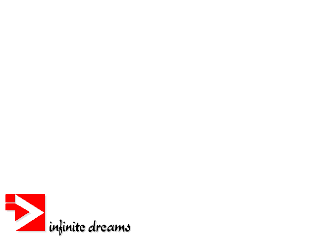
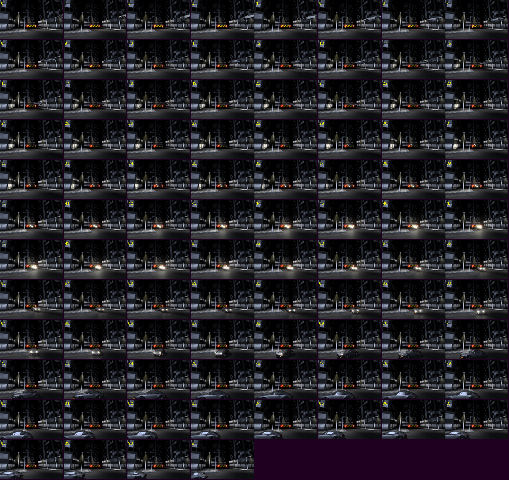
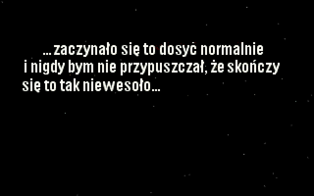
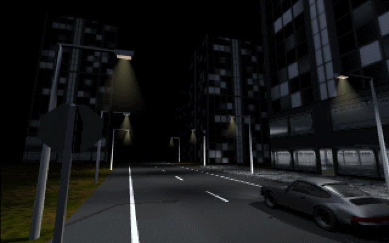
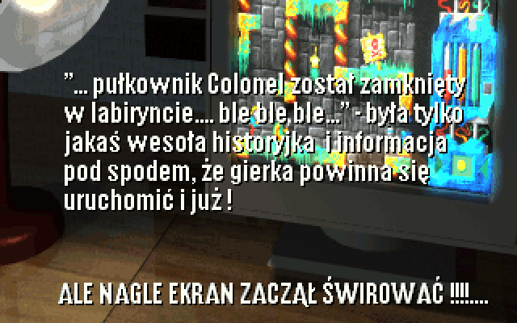
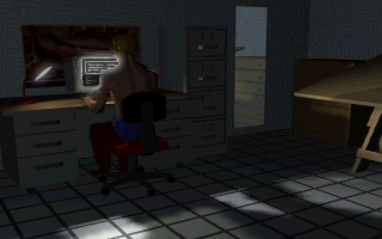
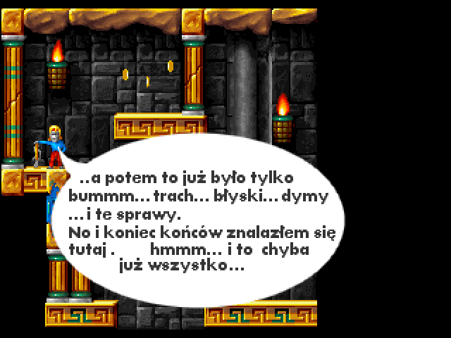
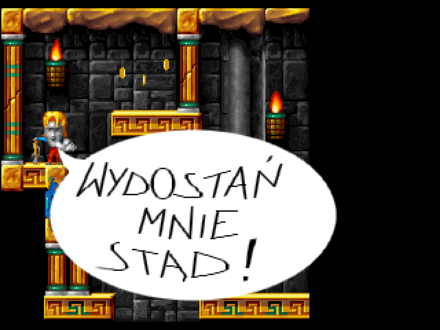
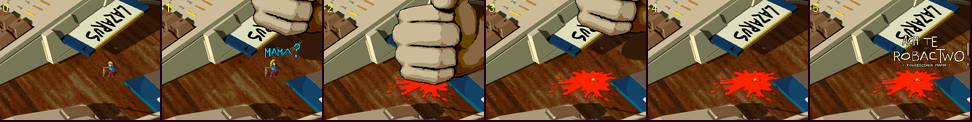

# 6. Intro, endings, credits and music

Everything the player sees and hears outside the rooms: shot-by-shot timing (from the code), the story text
that is baked into the images (transcribed, with translations), and the two music modules.
Timings assume the 50 Hz timer (PIT divisor `0x5D38`); on a slow 1996 PC the FLC decoding could stretch them.

## 6.1 Overall flow

```
DOS stub: Infinite Dreams logo (DATA22)          640x480x16      ~2 s while DOS/4GW loads
Intro (skip: /I, or Space/Esc at any time)       music: recollection (DATA39)        ~1:49
Title menu  GRA / AUTORZY / WYJŚCIE              music: multifruit juice (DATA23), loops
   AUTORZY → credits animation DATA04 (loops until Space/Esc), menu music keeps playing
   GRA     → music stops; the game itself has NO music, only sound effects
Endings:
   death / bomb / wrong potion → GAME OVER (DATA20) → back to the title menu
   "herbs" potion              → joke ending (DATA21) → exit to DOS
   Door of Time                → ending sequence (DATA17 + text) → credits scroller (DATA40)
                                 with music recollection (DATA39) → exit to DOS
Exit to DOS prints "Dzieki za gre w Lazarusa" ("Thanks for playing Lazarus").
```



## 6.2 The intro (`PlayIntro`, `0x1E8D0`)

Music: `recollection` starts just before the intro and is stopped after it (`main`). The intro is a mix of
three primitives:

* **`PlayFLC(file, ticks_per_frame, last_frame)`** (`0x1E1C4`) – shows frames `0..last_frame` (looping the
  file if it has fewer frames: after the last frame comes the file's ring frame, which brings back frame 0,
  then frame 1…), waiting `ticks_per_frame` 50 Hz ticks before each frame; `-1` = use the file's
  speed converted with `ms * 7 / 100` (66 ms → 4 ticks). Space or Esc aborts the whole intro.
  The 320×240 files play in Mode X with two video pages: each frame is drawn to the hidden page, which is
  then shown (`FLC_ShowModeX`, `0x1E140`), and PlayFLC ends by showing page 0 again. With an odd number of
  frames the last one is therefore never seen: DATA10's seventh frame (the ring frame = the empty balloon)
  flashes on page 1 and the full "WYDOSTAŃ MNIE STĄD!" (frame 5, page 0) stays on screen — confirmed by
  recording the original in DOSBox.
* **`ShowPCX(file, scroll_lines, hold_ticks)`** (`0x1E4D4`) – shows the top 320×200 of a 256-colour PCX,
  waits `hold_ticks`, then scrolls down one line every 3 ticks for `scroll_lines` lines (so a 320×400 PCX is a
  two-page text that scrolls up).
* **`Delay(ticks)`** – pause; Esc/Space aborts.

| t (s) | step | file | mode | playback | what is shown |
|---|---|---|---|---|---|
| 0.0 | Delay 50 | | 13h | 1 s black | |
| 1.0 | ShowPCX | DATA33 (320×400) | 13h | hold 3 s, scroll 200 lines (12 s), then 4 s | text over starfield → Earth (text **I-1**, **I-2**) |
| 20.0 | PlayFLC | DATA05 (59 fr) | 13h | 4 ticks/fr (12.5 fps), 59 frames | rotating Earth in space |
| 24.7 | PlayFLC | DATA06 (92 fr) | 13h | file speed (4), frames 0–90 | night city street, car parked; a sports car drives off |
| 32.0 | PlayFLC | DATA07 (51 fr) | 13h | 4, frames 0–45 | city road, car drives away |
| 35.7 | Delay 25 | | | 0.5 s | |
| 36.2 | PlayFLC | DATA08 (60 fr) | 13h | 4, frames 0–59 | country road at night, headlights approach |
| 41.0 | PlayFLC | DATA09 (87 fr) | 13h | 4, frames 0–85 | the car arrives at a small house with palm trees |
| 47.9 | ShowPCX | DATA34 | 13h | ~5 s | house at night (text **I-3**) |
| 52.9 | ShowPCX | DATA35 | 13h | ~5 s | the narrator at his desk in front of the PC |
| 58.0 | ShowPCX | DATA36 (320×400) | 13h | hold 6 s, scroll 12 s, then 6 s | desk lamp + monitor showing Lazarus (text **I-4**, **I-5**) |
| 82.0 | PlayFLC | DATA11 (2 fr) | 13h | 3 ticks/fr, 71 frames (loop) | the room flickers |
| 86.3 | PlayFLC | DATA12 (FLI, 2 fr) | 13h | 3, 51 frames (loop) | the narrator's face, flickering |
| 89.3 | *switch to Mode X 320×240* | | | | |
| 89.3 | PlayFLC | DATA15 (3 fr) | X | 8 ticks/fr, 61 frames | hero in the start room (7,0), speech balloon **I-6** |
| 99.1 | PlayFLC | DATA13 (3 fr) | X | 8, 31 frames | balloon **I-7** |
| 104.1 | PlayFLC | DATA14 (4 fr) | X | 10, 5 frames | empty balloon |
| 105.1 | PlayFLC | DATA10 (6 fr) | X | 30 ticks/fr, 7 frames | "WYDOSTAŃ MNIE STĄD!" written out piece by piece (**I-8**) |
| 109.3 | wait | | | until Enter/Ctrl/Space | the full sentence stays (see PlayFLC above) |

Storyboards (every frame): `assets/animations/storyboards/DATAxx.png`; individual frames in
`assets/animations/DATAxx/`.



| | | |
|---|---|---|
|  |  |  |
|  |  |  |

### Intro text (baked into the images)

| id | where | Polish (original, typos kept) | English |
|---|---|---|---|
| I-1 | DATA33 page 1 | …zaczynało się to dosyć normalnie i nigdy bym nie przypuszczał, że skończy się to tak niewesoło… | …it all started quite normally, and I would never have guessed it would end so badly… |
| I-2 | DATA33 page 2 | Wybrałem się do sklepu po najnowszą gierkę – LAZARUS czy jakoś tak… Słyszałem, że jest naprawdę niezła, więc się trochę napaliłem. Wszystko szło normalnie… no może tylko że tym razem miałem troszku daleko do sklepu. A droga powrotna dosyć się dłużyła… | I went to the shop for the newest game – LAZARUS or something like that… I'd heard it was really good, so I got a bit excited. Everything went normally… well, except that this time the shop was a bit far. And the way back dragged on and on… |
| I-3 | DATA34 | No i w końcu dojechałem do mojego imtymnego domku na działce. Teraz to już tylko sekundy dzieliły mnie od tej chwili kiedy wsadzę dysk i … | And finally I got to my cosy little cottage on the allotment. Now only seconds separated me from the moment I'd put the disk in and… |
| I-4 | DATA36 page 1 | …no kur[☠✂☁], co jest !!! – przekląłem szpetnie, bo sytuacja wyglądała naprawdę niewesoło – gierka nie chciała się odpalić. Miałem dość wpatrywania się w ekran (co za dużo to i świnia nie może) i nerwowo chwyciłem instrukcję w poszukiwaniu pomocy… | …what the f[censored], what's going on!!! – I swore horribly, because things looked really grim – the game wouldn't start. I'd had enough of staring at the screen (enough is enough, even for a pig) and nervously grabbed the manual for help… |
| I-5 | DATA36 page 2 | "… pułkownik Colonel został zamknięty w labiryncie…. ble ble ble…" – była tylko jakaś wesoła historyjka i informacja pod spodem, że gierka powinna się uruchomić i już! **ALE NAGLE EKRAN ZACZĄŁ ŚWIROWAĆ !!!….** | "…Colonel Colonel has been locked in a labyrinth… blah blah blah…" – it was just some silly story and a note underneath saying the game should simply start! **BUT SUDDENLY THE SCREEN WENT CRAZY!!!…** |
| I-6 | DATA15 balloon | …a potem to już było tylko bummm… trach… błyski… dymy …i te sprawy. No i koniec końców znalazłem się tutaj. hmmm… i to chyba już wszystko… | …and then it was just boom… crash… flashes… smoke… and all that. And in the end I ended up here. Hmm… I guess that's all… |
| I-7 | DATA13 balloon | aha… jeszcze jedna mała sprawa… | oh… one more little thing… |
| I-8 | DATA10 balloon | WYDOSTAŃ MNIE STĄD! | GET ME OUT OF HERE! |

## 6.3 Title menu (`TitleMenu`, `0x29714`)

* Palette DATA28, music *multifruit juice* (looping). Background = sprite frame 1181 (group 226); the
  highlighted option is drawn over it: frame 1178 "GRA" at (139,89), 1179 "AUTORZY" at (113,122),
  1180 "WYJŚCIE" at (116,160) — the background already contains the dimmed labels. The highlights are
  play-field coordinates (screen y + 6, see 3.7); the background is drawn at screen (0, 0).
* ↑/↓ cycle (wrapping), Enter or Space select, Esc = WYJŚCIE.
* **AUTORZY** (credits) plays DATA04 (19 frames, 4 ticks per frame) in a loop until Space or Esc. Final frame:
  *CODE* Marcin Pancewicz · *GFX* Tomasz Kostrzewski · *MUSIC* Wojciech Panufnik · *IDEA* Marek Augustyn,
  Tomasz Kostrzewski · Infinite Dreams logo.


## 6.4 In-game audio

When GRA is chosen the module is stopped: **the game has no background music**. Atmosphere comes from the
54 sound effects (`assets/sounds/`), including room ambience emitted by invisible objects (water drips etc.),
looping machinery, the jetpack loops and the bomb's ticking. See 2.9 and 3.9.

## 6.5 Endings

### Game over

Energy at zero, the bomb, the wrong wire, or the witch's *syrop Wiecznego Życia* (*"Oops!! Musiałam coś
popieprzyć! PRZEPRASZAM!!!"* – "Oops!! I must have messed something up! SORRY!!!") end the game:
palette fade, then **DATA20** "GAME OVER" (640×480×16), wait for Enter/Ctrl/Space, back to the title menu.
Explosions first flash white and fade through the red-only palette with sounds 5 and 6.

### Joke "happy ending" (witch's *ziółka Szczęśliwego Zakończenia*)

After *"To chluśniem, bo uśniem!"* the palette fades to black and **DATA21** is shown; any key exits to DOS.

> **Oto i szczęśliwe zakończenie!!!** Szczęśliwe dla Ciebie, ale nie dla twojego bohatera, który będzie się
> błąkał po labiryncie aż do wyłączenia komputera. Chyba, że spróbujesz jeszcze raz i nie dasz się nabrać na
> numer ze szczęśliwym zakończeniem!
>
> *And here is the happy ending!!! Happy for you, but not for your hero, who will wander the labyrinth until
> the computer is switched off. Unless you try again and don't fall for the "happy ending" trick!*

### Winning ending (`EndingSequence` `0x1EBC4` + `EndingCredits` `0x299BC`)

Walking through the Door of Time (script 165) fades to black, then (no music):

| t (s) | what |
|---|---|
| 0 | first frame of **DATA17**: the tiny hero on the narrator's desk, next to the LAZARUS floppy |
| 2 | nine lines appear one by one every 1.8 s (messages 284–292, below) |
| 18.2 | DATA17 plays at 20 ticks/frame (7 frames): *"MAMA?"* – a giant fist slams down – red splat – *"ACH TE ROBACTWO! (powiedziała mama)"* |
| 21 | 4 s pause |
| 25 | **credits scroller**: music *recollection* starts, DATA40 (640×2080×16) scrolls up 1 600 lines at one line per 4 vertical retraces (≈15 px/s, ≈107 s), then waits for a key; exit to DOS |

| msg | Polish | English |
|---|---|---|
| 284 | HURRAA !!! Udało sieeee….eee.ee… | HURRAY!!! I made iiiit….t..t… |
| 285 | co jest !?! | what's going on?! |
| 286 | Gdzie ja jestem !?! | Where am I?! |
| 287 | Co tutaj robi ten przerośnięty komputer !?! | What is this oversized computer doing here?! |
| 288 | Czyżby to było moje biurko ??… | Could this be my desk??… |
| 289 | Ale przecież miałem AMIGĘ a nie grzyba!!! | But I had an AMIGA, not this PC junk (lit. "mushroom")!!! |
| 290 | Oj ! Coś mam przeczucie, że teraz dopiero zaczną się niezłe szopki – za duże buty, za duża łyżka do zupy… | Uh-oh! I have a feeling the real circus only starts now – shoes too big, soup spoon too big… |
| 291 | … jejku to straszne !!! | …oh no, this is terrible!!! |
| 292 | MAMOOO !!!!! | MUUUUM!!!!! |
| DATA17 | ACH TE ROBACTWO! (powiedziała mama) | Ugh, these bugs! (said Mum) |



### Credits scroller text (DATA40)

*LAZARUS development team* —
**Programowanie** (code) Marcin Pancewicz · **Grafika** (graphics) Tomasz Kostrzewski ·
**Muzyka** (music) Wojciech Panufnik · **Scenariusz** (story) Marek Augustyn, Tomasz Kostrzewski ·
**Pomysły** (ideas) Marek Augustyn, Tomasz Kostrzewski · **Additional pomysły** Agnieszka, Krzysztof Augustyn,
Jarosław Burkacki, Wojtek · **Testowanie** (testing) Krzysztof Augustyn, Jarosław Burkacki, Adam Doligalski,
Krzysztof Hliniak, Agnieszka Kostrzewska, Wojtek Kostrzewski, Jarosław Krupa, Dariusz Kustra, Tomasz
Ławrynowicz, Józef Ober, Mikołaj Pancewicz, Marcin Witek, Marek Wyszyński ·
**Na podstawie gry Lazarus by** (based on the game Lazarus by) Krzysztof Augustyn ·
**Intro** Tomasz Kostrzewski · **Efekty dźwiękowe** (sound effects) Marek Augustyn ·
**Dialogi** (dialogues) Marek Augustyn, Tomasz Kostrzewski.

**Dane techniczne** (technical data): 15 000 lines of code, 700 animation frames, 610 blocks, 100 rooms,
120 backgrounds, 45 monsters, 6 months of work.

**Produkcje "Infinite Dreams"** – Amiga: Pinomania, Alien Target, Bridge 1.1, Lazarus, Desert Wolf;
PC: Xenologic, Lazarus. (So the PC game is a port of the team's own Amiga *Lazarus*, which matches the
big-endian Amiga data and the "AMIGA" jokes.)

Closing message (translated): *"To tell the truth, our hero fibbed a little at the start of the intro. He
didn't buy the original game at all!!! And he wasn't sucked into the computer by accident. That can happen to
anyone who buys illegal software! Of course it would be wrong to conclude that pirated games bring awesome
adventures… The truth is: if you let the pirates at the computer fair earn money, then instead of making
games we'll switch to herding sheep! See you in the mountains – THE AUTHORS"* (with a drawing of a sheep),
followed by *"All characters and events are fictional; any resemblance to real persons or events is
coincidental!!"* and the Infinite Dreams 1996 logo.

## 6.6 Music

| | `multifruit_juice.mod` (DATA23) | `recollection.mod` (DATA39) |
|---|---|---|
| used for | title menu (loops); stopped when a game starts | intro; end-credits scroller |
| format | ProTracker `M.K.`, 4 channels, 31 samples | ProTracker `M.K.`, 4 channels, 31 samples |
| orders / patterns | 17 / 12 | 36 / 22 (libopenmpt also finds a 2nd sub-song) |
| length (one pass, libopenmpt) | 1:23.8 | 2:22.1 |
| composer | Wojciech Panufnik ("Snoopy of Scope") | Wojciech Panufnik ("Snoopy of Energy") |
| notes in the sample names | an older demoscene tune, dedicated to "Lenny of Scope" for his 18th birthday | "composed & sampled by", release date **02.07.94**, "the 1st tune I composed for almost 2 years which has less than 100kb" |

Both modules predate the game (Amiga demoscene tracks reused for Lazarus). The sample-name texts also contain
the composer's 1994 postal address and phone number; they are in the files but deliberately not repeated here.

The game plays modules with its own mixer (Sound Blaster: software mixing — the help text says 28 kHz by
default, `/Rnnnn` changes it, and `/D` reports the rate actually used: 14 000 Hz with DOSBox's SB16;
Gravis UltraSound: hardware voices). The intro (~1:49) ends before *recollection* finishes; the
title tune loops.

Files: `assets/music/*.mod` (originals, play in any tracker / libopenmpt), `*.ogg` previews rendered with
libopenmpt 0.7.3 at 44.1 kHz (one pass, not the original mixer), `music.json` (metadata and order lists).

## 6.7 Notes for the remake

* The intro and ending text is part of the images. For a translation, recreate the text pages from the
  transcriptions above and keep the timings (hold, 3-ticks-per-line scroll, delays).
* The FLC animations are pre-rendered 3D at 320×200/240; upscaling them works best per-frame from
  `assets/animations/` (they have no alpha; Mode X parts are 320×240).
* Keep the skip behaviour: Space/Esc skips the whole intro; credits loop until a key.
* There is no in-game music in the original; adding some is a design decision for the remake. The Godot
  remake plays the two modules in turn while playing (on by default; Options → *Muzyka w grze* turns it
  off for the original's silence).
