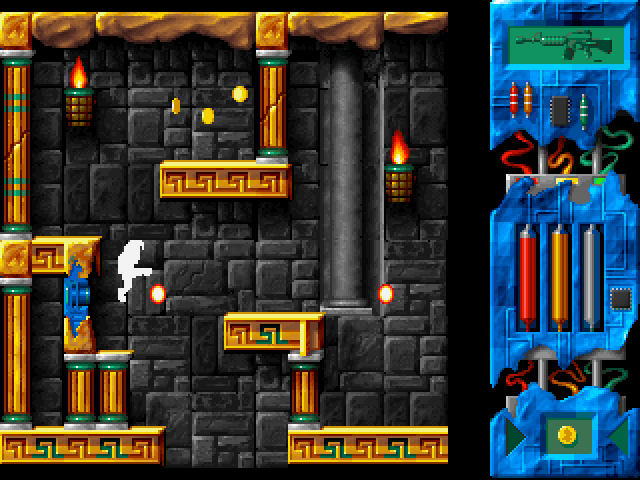
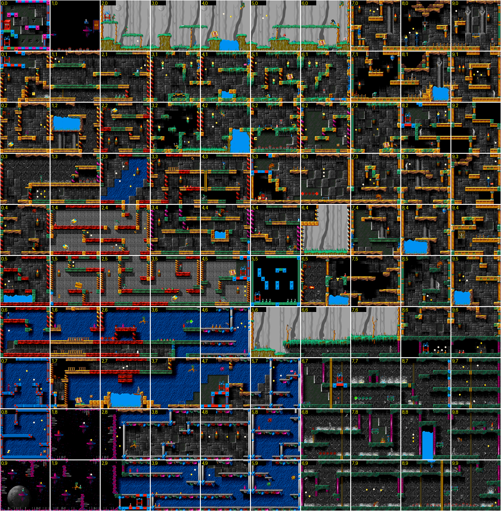

# Lazarus (DOS, 1997) — reverse-engineering notes

Reverse engineering of the Polish DOS game **Lazarus** by Infinite Dreams (released 1997), done as groundwork for a
modern remake. The game was analysed from the release files (`LAZARUS.EXE` + `DATA01–41.RES`) by
disassembling/decompiling the DOS/4GW executable and verifying findings against the original running in
DOSBox.

| document | contents |
|---|---|
| [01-executable.md](01-executable.md) | binary layout, toolchain, startup, command-line switches, cheat codes, classes, globals, how to reproduce the disassembly/decompilation |
| [02-file-formats.md](02-file-formats.md) | every `DATAxx.RES` format: tiles, sprites (BOBs), rooms, room objects, font, sounds, palettes, FLC/PCX/MOD |
| [03-engine.md](03-engine.md) | game loop, collision, hero state machine and physics constants, object/path system, weapons, HUD, dialogue, sound, randomisation |
| [04-game-content.md](04-game-content.md) | story, world and teleports, all items, NPCs and shops, quest chain, script reference, endings |
| [05-remake-guide.md](05-remake-guide.md) | recommendations, fidelity checklist, the Godot remake built on these notes (5.7), open questions, legal note |
| [06-cutscenes-and-music.md](06-cutscenes-and-music.md) | boot logo, intro shot list with timing and transcribed/translated text, title menu, credits, all endings, credits scroller, music analysis |
| [07-world-and-catalogues.md](07-world-and-catalogues.md) | regions and room connectivity, teleport graph, gates, all lifts/doors and what opens them, secret passages, collision/path debug renders, enemy catalogue, sound usage, unused/cut content, quest dependency graph, completability check and walkthrough |
| [08-history.md](08-history.md) | the C64 (1994) and Amiga (1995) games this port descends from, credits, the studio, sources |

## Quick facts

* 10×10 single-screen rooms, play-field 224×228 px (14×12 tiles of 16×19 over 7×6 tiles of 32×38),
  Mode X 320×240, 256 colours, one palette for the whole world, 50 Hz fixed tick.
* 956 sprite frames (1 184 descriptors incl. separators) in 229 animation groups (227 non-empty), 560 platform tiles, 120 background tiles.
* 7 regions connected only by teleports; 40 fake walls (animated tiles never collide); 155 shootable
  enemies, 104 indestructible hazards; 54 sound ids built from 23 samples.
* 699 data-driven room objects (enemies, items, NPCs, doors, lifts, triggers) using one keyframe/physics
  "path" format; ~110 hard-coded script handlers for quests and dialogue; 293 Polish text strings.
* 6 weapons, jetpack with fuel, inventory of up to 40 items (38 item kinds), money, shops, 6 teleport
  destinations unlocked by passwords, 3 endings.
* Data authored on the Amiga (big-endian) and converted; the game itself is Watcom C++ for DOS/4GW — a port
  of the 1995 Amiga *Lazarus*, itself based on Krzysztof Augustyn's 1994 C64 game (chapter 8). The DOS
  version was released in 1997 (its title screen says 1996).

| title | gameplay | dialogue |
|---|---|---|
|  |  |  |

The converted assets are in [`assets/`](../../assets/README.md); an annotated decompilation of the executable
is in [`reference/`](../../reference/README.md).

## Tools (in `tools/`)

| tool | purpose |
|---|---|
| `extract_assets.py` | export everything to PNG/WAV/MOD/JSON/Tiled/BMFont (`python3 tools/extract_assets.py <game dir> assets/`) |
| `dump_rooms.py` | readable listing of room objects / quest objects / one room with its path steps |
| `lazarus_data.py` | Python readers for all resource formats |
| `lazarus_exe.py` | tables embedded in the EXE: messages, sounds, weapons, items, scripts, tile animations |
| `lazarus_names.py` | human names for items, sounds, sprite groups, scripts, pictures |
| `lazarus_scripts.py` | all script/item handlers of the EXE as data, validated against the EXE tables (`script_logic.json`) |
| `reference_sim.py` | the movement code (tile collision, hero states, object paths, animation) re-implemented; golden traces |
| `completability.py` | completability check and walkthrough: search over items, flags, passwords, money and doors with free-flight reachability (`--all-seeds`, `--necessity`) |
| `pixel_check.py` | patches a scratch copy of the EXE to start frozen in any room and compares DOSBox screenshots with our renders |
| `world_analysis.py` | room-edge connectivity, regions, teleports, fake walls, collision/path debug renders (`world_graph.json`) |
| `catalogues.py` | enemies, hero spec, sound usage, unused content (`assets/gamedata/*.json`) |
| `build_remake_data.py` | the Godot remake's data bundle (`remake/data/`): index-image atlases, rooms, texts, handlers, sounds |
| `le_loader.py` | LE (DOS/4GW) loader with fixups |
| `disasm.py` | annotated linear disassembly (capstone) using `symbols.txt` |
| `make_flat_image.py` + `ghidra/` | inputs, post-script and annotator for the Ghidra decompilation in `reference/` |
| `mazovia.py` | Mazovia (Polish DOS code page) codec |
| `flc.py` | FLI/FLC decoder |
| `symbols.txt` | ~180 recovered function and variable names |

Requirements: Python 3.9+, `pip install -r tools/requirements.txt` (Pillow, capstone).

## Running the original for comparison

`cd original && dosbox -conf dosbox.conf` (DOSBox 0.74+; add `/N` if sound causes trouble, `/I` to skip the
intro). Cheats `IDMORT` (invulnerable), `IDLUFA` (all weapons), `IDSIAR` (infinite ammo/fuel) help
when checking rooms.
