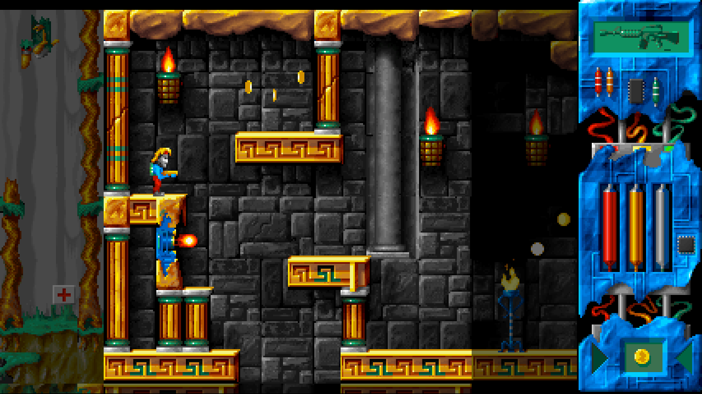

# Lazarus '97: Revibed — the Godot 4 remake

A remake of **Lazarus** (Infinite Dreams; based on the DOS version released in 1997) in **Godot 4.7**,
playable in a web browser, widescreen and HD, with keyboard, gamepad and on-screen touch controls.

**Play: <https://mbialkowski.github.io/lazarus-revibed/>** (built and published from `main` by CI).



## Design

* **Same rules as the original.** The hero (states, jump/fall/jetpack physics, all-or-nothing tile
  collision), the room objects (paths, animations, activation, triggers, chained objects, solid platforms
  that push and carry), shots, damage, the inventory and every quest/dialogue handler are ported from the
  decompilation (`reference/lazarus.c`) and run at the original's fixed **50 Hz** with its integer /
  16.16 arithmetic. The handlers run from `assets/gamedata/script_logic.json` (docs 4.9).
* **Rendered like a VGA game.** Everything is drawn in palette indices into a 240-pixel-high off-screen
  image and coloured by a shader with the current palette, so the original's palette fades, the bomb's
  alarm palette and the explosion flashes are exact. The shader scales with "sharp bilinear" filtering:
  crisp pixels of even size at any HD resolution.
* **Widescreen.** The logical screen is as wide as the window (320–640 px for 240 px height). The hero's
  room is centred, the neighbouring rooms are visible (dimmed) around it and the original HUD panel sits at
  the right; the camera glides when the hero walks into the next room. Only the hero's room is live, as in
  the original — its neighbours are shown as they look on entry and come alive when he walks in.
  On 4:3 screens it looks like the original.
* **Room edges like the original.** The hero crosses room edges exactly as in the original
  (Hero_MoveCollide: placed fully inside the new room, a 14–30 px jump at top and bottom edges). That jump
  is a boost the level design relies on: some platforms can only be reached with it (docs 3.2), so there is
  no option to change it.

* **Intro and endings.** The original's 110-second intro (FLC animations and scrolling story pages, with
  *recollection*) plays at start-up with the original timings, with English subtitles for the painted-in
  Polish text when the language is English; any key or a tap skips it. It ends, like the original, on the
  full "WYDOSTAŃ MNIE STĄD!" (docs 6.2: Mode X page flipping hides the animation's last frame), which stays
  4 seconds, or until a key or tap, before the title (the original waits for a key). The credits animation,
  the game-over picture, the joke ending and the winning ending with the credits scroller are there too.
* **Music while playing.** The original plays its two modules only in the intro, on the title screen and
  in the end credits; the game itself has only sound effects. The remake also plays *recollection* and
  *multifruit juice* in turn during the game; Options → *Muzyka w grze* turns that off for the original's
  silence.

Details that differ from the original on purpose: shots touching harmful tiles do not hurt the hero (an
original bug); the riddle scroll shows the third riddle's own picture (another original bug, fixed by
`tools/build_remake_data.py`); a hero placed inside a platform when entering a room is moved to the nearest
free spot (in the original he is stuck for good, docs 3.2); the bullets of the hero's room are drawn clipped to it; the menus below (the original had
only GRA / AUTORZY / WYJŚCIE and no pause; its unused "Pauza" text exists); music while playing (can be
turned off); saving. The game starts in Polish with the original texts; English (`data/text_en.json`) can be
chosen on the first screen or in the options.

## Menus

* **First screen** (in the browser; browsers only start audio after an input): Polski / English, chosen
  with the arrow keys or a click / tap on the name, then any key. On a phone held upright it also says
  "Obróć telefon poziomo - wygodniej się gra" (turn the phone sideways: the picture is much larger).
* **Title menu**: NOWA GRA, GRAJ DALEJ, OPCJE, STEROWANIE, AUTORZY, WYJŚCIE as one list over the original
  picture, whose painted GRA / AUTORZY / WYJŚCIE are only background (the list's WYJŚCIE sits on the
  painted one). GRAJ DALEJ (continue) is greyed out until there is a saved game: the game is saved each
  time the hero enters a room (the original had no saving: one death was game over). In the browser
  WYJŚCIE only shows "Dzięki za grę w Lazarusa!".
* **Pause menu** (Esc, Start, the II button): Graj dalej, Opcje, Sterowanie, Wyjdź do menu.
* **Sterowanie** (controls): what each key does, or each touch button when the touch controls are on.
* **Opcje** (options), saved in `user://settings.cfg`:

| option | values | |
|---|---|---|
| Język / Language | Polski, English | |
| Sąsiednie komnaty | tak / nie | show the neighbouring rooms |
| Przyciemnij sąsiednie | tak / nie | dim them |
| Skalowanie | gładkie / ostre | sharp-bilinear or nearest-pixel scaling |
| Sterowanie dotykowe | auto / tak / nie | touch controls (auto: on touch screens) |
| Dźwięk | tak / nie | all sound; while off the three rows below are greyed out and skipped |
| Muzyka | 0–100 % (70 %) | music volume |
| Muzyka w grze | tak / nie | music while playing (the original has none) |
| Efekty | 0–100 % (20 %) | sound effect volume |
| Pełny ekran | tak / nie | hidden where the browser cannot go full screen (iPhone) |

## Controls

| action | keyboard | gamepad | touch |
|---|---|---|---|
| walk | ← → (or A D) | d-pad / left stick | pad |
| jump / jetpack thrust, menu up | ↑ (or W) | A, d-pad up | SKOK (JUMP), pad up |
| crouch (pick up), menu down | ↓ (or S) | d-pad down | pad down |
| fire | Ctrl (or J, X) | X, right trigger | STRZAŁ (FIRE) |
| use / talk / confirm | Enter (or E, K) | B | UŻYJ (USE), tap |
| jetpack on/off | Space (or L) | Y | JETPACK |
| previous / next item | , . (or Q, Tab) | LB / RB | RZECZ (ITEM), tap the HUD item |
| weapon | 1–6, R = next | Back | BROŃ (GUN), tap the HUD weapon |
| pause / options | Esc (or P) | Start | II |
| full screen | F11, Alt+Enter | | [ ], options |

Holding ↓ keeps the hero crouched, as in the original. Dialogues continue with Fire, Enter, Space or a
tap. The original's cheats work (`IDMORT`, `IDSIAR`, `IDLUFA`, `IDBULL`).

**Phones.** Sideways the touch pad and buttons lie over the picture; upright they sit below it. The
[ ] button only appears where the browser can go full screen (not on iPhone, where *Share → Add to Home
Screen* installs the game as a full-screen app locked to landscape). Sound plays even with an iPhone in
silent mode (see Running).

## Running

```bash
python3 tools/build_remake_data.py original/ remake/data/      # only after changing the converter (needs original/)
godot --path remake                                            # play (Godot 4.7, "Compatibility" renderer)
godot --headless --path remake --export-release Web remake/build/web/index.html
```

The web export is single-threaded (no special HTTP headers needed), so `remake/build/web/` can be served
by any static web server or GitHub Pages; it installs as a full-screen landscape app (PWA) on phones.
Export templates: Godot 4.7.2 (`Editor → Manage Export Templates`).

Sound in the browser starts with the first key, click or tap. A small script in the page head (the Web
preset's `html/head_include`) resumes it after every input (browsers suspend audio after calls or app
switches) and makes it play while an iPhone is in silent mode, which otherwise mutes web audio.

## Tests

```bash
godot --headless --path remake --script res://tests/check.gd       # every script parses
godot --headless --path remake --script res://tests/golden.gd      # 63/63 golden traces (hero + objects)
godot --headless --path remake --script res://tests/scenarios.gd   # coins, shop, save/load, shooting, teleport, crouch, room-edge clip, riddle scroll, death
godot --headless --path remake --script res://tests/walkthrough.gd # the solver's winning route, 109 steps
godot --path remake -- --shots=/tmp/shots                          # screenshots of title, start, walk
node remake/tests/web_smoke.mjs remake/build/web /tmp/web-shots    # web build in headless Chromium
```

`golden.gd` replays `assets/gamedata/golden_traces.json` (made by `tools/reference_sim.py` from the
decompiled movement code) through the remake's hero and objects and compares every tick.
`walkthrough.gd` replays `assets/gamedata/walkthrough.json` (`tools/completability.py`) through the remake's
room objects and script VM — every item, lock, chain, flag and handler on the way to the Door of Time —
and must end with the winning ending. CI (`.github/workflows/remake-web.yml`) runs all of them, exports the
web build and publishes it on GitHub Pages from `main` (<https://mbialkowski.github.io/lazarus-revibed/>;
the repository's Pages source must be "GitHub Actions").

## Layout

| path | what |
|---|---|
| `data/` | **generated** by `tools/build_remake_data.py`: index-image atlases, rooms and object records, texts, handlers, sounds, music, pictures (never edit by hand) |
| `scripts/sim/` | the game rules: `sim.gd` (the 50 Hz GameLoop), `hero.gd`, `room.gd`, `room_object.gd`, `bullet.gd`, `state.gd` |
| `scripts/game/` | `data.gd` (loading, settings), `script_vm.gd` (quest/dialogue handlers), `audio.gd`, `strings.gd` (menu texts, Polish and English: only the original font's characters, U+2010 for a short hyphen) |
| `scripts/view/` | `screen.gd` (indexed renderer), `palette.gd` + `palette.gdshader`, `text_layer.gd` (dialogue font), `touch.gd` |
| `scripts/main.gd` | title, options, pause, game, pictures, endings, input, layout |
| `tests/` | the tests above |

The remake's code is MIT licensed; the original game's content (`data/` and everything converted from the
original files) is not: all copyrights remain with Infinite Dreams and the other original rights holders
(see the main README's License section).
